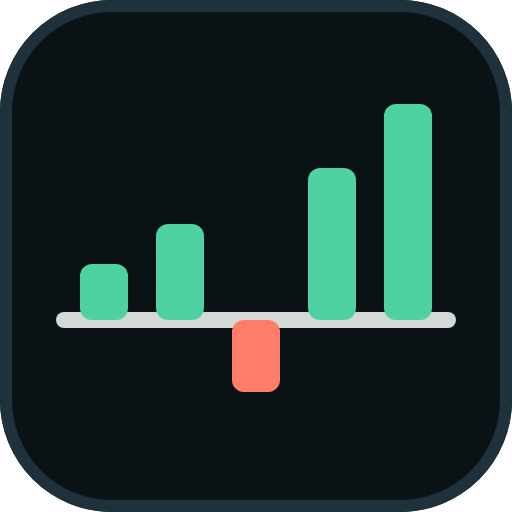

<p align="center"></p>

# Treading — دفتر التداول

واجهة + خادم صغير + قاعدة MongoDB لعرض صفقات حساب MetaTrader 5 (مفتوحة ومغلقة، منحنى أداء، نسبة فوز).

```
frontend/   الواجهة (HTML/CSS/JS عادي، بدون build)
server/     خادم Express + MongoDB + استيراد تلقائي لملف المنصة
test/       اختبارات (node --test)
```

## كيف تعمل

```
MT5 (المؤشر GoldMarketAnalyzer) ──يكتب──> Common\Files\trade_journal.csv
                                              │  (الخادم يراقبه كل 3 ثوانٍ)
                                              ▼
                              MongoDB Atlas (مجموعة trades)
                                              │
                          الواجهة ──GET /api/trades──┘
```

- الصفقات **المغلقة تبقى في قاعدة البيانات للأبد** حتى لو قصّت المنصة تاريخها.
- الصفقات **المفتوحة** تتطابق مع آخر لقطة وتُحذف عند إغلاقها.
- بدون الخادم، افتح `frontend/index.html` من القرص مباشرة وتقرأ الصفحة ملف المؤشر المحلي.

## التشغيل

```bash
npm install
cp .env.example .env     # ثم املأ MONGODB_PASSWORD
npm start                # http://127.0.0.1:3000
npm test
```

في `.env`: ضع كلمة سر مستخدم Atlas في `MONGODB_PASSWORD` (يرمّزها الخادم تلقائياً، فلا مشكلة مع الرموز الخاصة).
ملف `.env` **لا يُرفع إلى git**.

في Atlas: **Network Access** أضف عنوان IP جهازك، وتأكد أن المستخدم له صلاحية قراءة/كتابة.

## الأمان

- الخادم يستمع على `127.0.0.1` افتراضياً (جهازك فقط).
- لو غيّرت `HOST=0.0.0.0` للوصول من الجوال، **لازم** تضبط `API_TOKEN`، وإلا يرفض الخادم التشغيل.
  الصفحة تسأل عن الرمز مرة وتحفظه في المتصفح.
- لا تنشر الخادم على الإنترنت بدون HTTPS (مثلاً خلف Cloudflare Tunnel أو Caddy).

## الواجهات

| المسار | الوصف |
|--------|-------|
| `GET /api/health` | فحص الحياة (بدون رمز) |
| `GET /api/trades?status=OPEN\|CLOSED&symbol=EURUSDm` | الصفقات |
| `POST /api/trades/sync` | يستقبل نص CSV (`Content-Type: text/csv`) ويحدّث القاعدة |

## النشر (للمتابعة من الجوال من أي مكان)

نفس أسلوب مشروع 3BRO: ملف `render.yaml` ثم Render. عندنا خدمة **واحدة** تقدّم الواجهة والـ API معاً،
وبقاء الريبو خاصاً (GitHub Pages لا يدعم الريبو الخاص على الخطة المجانية).

```
جهازك (npm start) ──يرفع الصفقات──> MongoDB Atlas <──يقرأ── Render (الواجهة + API) <── جوالك
```

1. **Atlas ← Network Access:** أضف `0.0.0.0/0` (عناوين Render متغيّرة). الحماية بكلمة سر المستخدم، فاجعلها قوية.
2. **Render ← New ← Blueprint:** اربط ريبو `Abalzunidi/Treading`. سيقرأ `render.yaml` تلقائياً.
3. عند الطلب أدخل **`MONGODB_URI`** (نفس الرابط الكامل مع كلمة السر؛ هو نفس الموجود في `.env` عندك).
4. بعد النشر افتح رابط الخدمة، وعند السؤال أدخل **`API_TOKEN`** (يولّده Render: لوحة الخدمة ← Environment).
   يُحفظ في متصفح جوالك، فلا يُسأل مرة ثانية.
5. **حتى تتحدّث الصفقات:** شغّل `npm start` على جهاز المنصة (يقرأ ملف MT5 ويرفعه إلى Atlas). السحابة تقرأ من Atlas فقط.

> الخطة المجانية في Render تنام بعد دقائق من عدم الاستخدام؛ أول فتح بعد النوم يأخذ نحو نصف دقيقة.

### نشر الواجهة على GitHub Pages

الواجهة (مجلد `frontend/`) تُنشر على `https://abalzunidi.github.io/Treading/` من فرع `gh-pages`:

```bash
npm run deploy:pages                              # بدون خادم: الصفحة تعمل وتقبل ملف CSV يدوياً
API_BASE=https://treading.onrender.com npm run deploy:pages   # لتقرأ الصفقات من خادم Render
```

> انتظر انتهاء النشر السابق (تبويب Actions) قبل نشر جديد، وإلا يفشل النشر الثاني بسبب تعارض.
> لو فعّلت صلاحية `workflow` لـ `gh` يمكن استبدال هذا بسير عمل Actions تلقائي.
